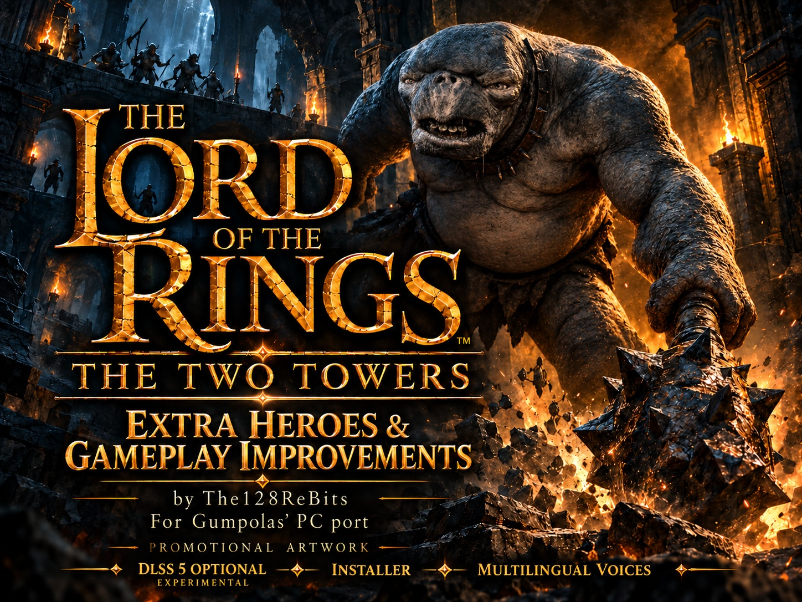
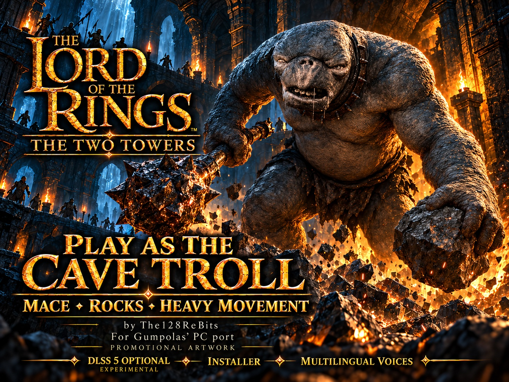
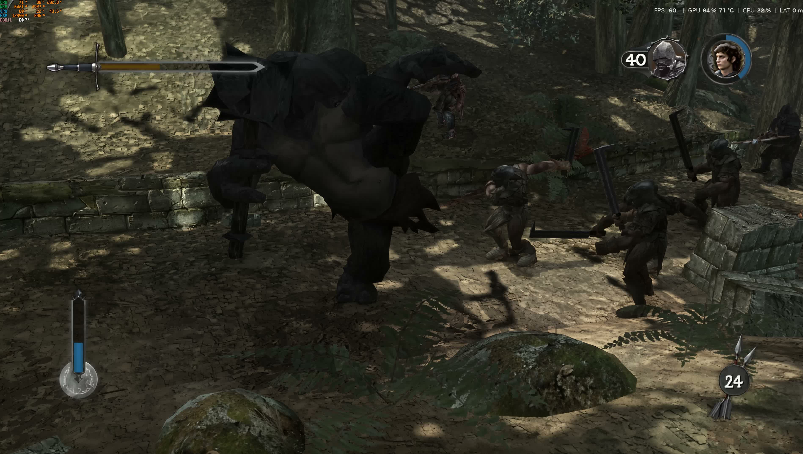
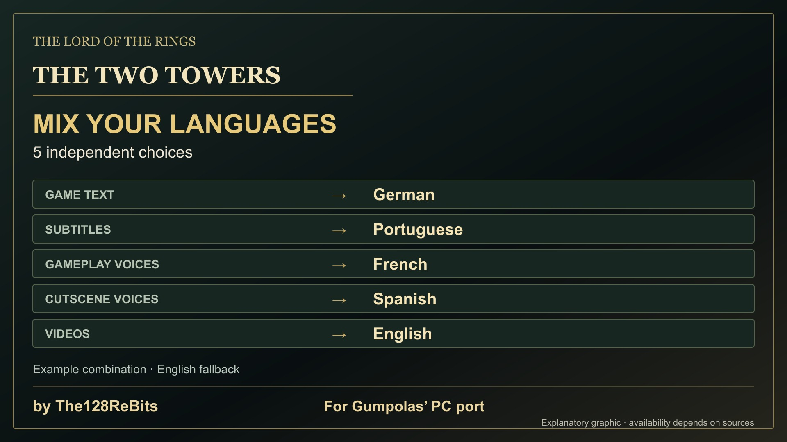

# The Lord of the Rings: The Two Towers — Extra Heroes & Gameplay Improvements

**Gameplay additions by The128ReBits for [Gumpolas’ original The Two Towers Recompiled PC port](https://github.com/Gumpolas/TooTawersRecomp).**

Take the Cave troll into battle with its huge frame, heavy movement, mace and throwable rocks. Add six playable characters, revisit combat across all 13 extra heroes and choose text, subtitles and voices independently. The roster grows from **11 to 17**.

[Download](https://github.com/The128ReBits/The-Two-Towers-Extra-Heroes-and-Gameplay-Improvements/releases/tag/extra-heroes-gameplay-improvements) · [ModDB](https://www.moddb.com/mods/the-two-towers-recompiled-definitive-mod-by-the128rebits) · [Original port](https://github.com/Gumpolas/TooTawersRecomp) · [Español](#español)

## Take the Cave troll’s side of the fight

You know what it feels like to face that mace. Here, you get to wield it. The playable Cave troll keeps its original size and heavy movement. Its deliberate swings give combat a different rhythm from the human heroes, while rocks provide a ranged option.

Getting that body under player control required adapting its native NPC attacks to player inputs and combos, fitting its mace and measuring the weapon from its actual mesh. Work on contact, weapon reach and nearby targets addresses the awkward situation where a huge visible swing can pass over a small enemy standing right beside you. The rock launch point was revised too, to keep shots from leaving a raised hand far above their intended targets.

The troll joins the character selector and individual-record systems, with its own experience, upgrades and scores. These are implemented adaptations and targeted revisions. Contact, rock behaviour and mission interactions still need further playtesting; every attack in every level has not been certified.

## Six additional heroes, 17 characters to choose from

- **Elven warrior:** an additional elven melee character built from the game’s own resources.
- **Elven archer:** a separate character with a bow and adapted melee. Its native melee source is limited: quick and strong attacks share a source gesture with different timing and events.
- **Cave troll:** original size, heavy movement, mace and throwable rocks.
- **Rohan captain:** a sword profile with native attack sequences adapted to player combos.
- **Uruk captain:** its own rig and native strikes, including a lateral sword-attack variant.
- **Gandalf the White:** white model and staff, sword and white-light magic presentation, with progression separate from Gandalf the Grey.

The six use **models and animations from the original game**. They extend the original port’s 11-character roster: four base characters plus Gumpolas’ seven original extras, **Boromir, Gandalf, Frodo, Lurtz, Elrond, Uruk-hai and Sauron**. The result is four base characters and 13 extras.

## Combat revisions across all 13 extras

This work includes the seven extras already provided by Gumpolas. It covers movements, combos, stance, movement between attacks, transitions, weapons, reach and damage events. Native sequences are adapted to the player’s combat system and upgrade chains.

Concrete examples from the reports:

- **Frodo:** corrected Xbox animation decoding avoids reading a rotation-sign bit as part of a timestamp. His short weapon also received a dedicated player-weapon profile.
- **Lurtz:** multiple strikes in a native sequence are separated into usable combo segments. The ground-finisher adaptation still needs in-game checks.
- **Rohan captain:** the strong native sequence is split at its strikes for use in player chains.
- **Uruk captain:** native quick strikes are separated and a lateral strong-attack variant is added.
- **Elven warrior and Elrond:** their two-strike source sequence is divided into combo segments. This is adaptation of existing material, without claiming a complete new moveset.
- **Both Gandalfs:** sword, staff and magic stay tied to their profiles; the White has a distinct presentation and record.

The **Xbox animation codec correction** separates 15-bit timing from quaternion sign and corrects interpolation and retiming. It supports the animation work above; it does not establish that every visible animation issue is solved.

## Start with everyone available, and still build your heroes

Campaign progression with extras is implemented so their victories can open the next mission. Each extra keeps individual experience, upgrade purchases and scores. Choose one of four modes:

1. **Extras off.**
2. **Normal unlocking**, with progression recorded.
3. **All extras for testing**, without writing saves.
4. **All extras available from the start, with real progression.**

New installations default to the fourth option; updates preserve your choice. Complete campaign runs and in-game save/load checks with each extra remain manual validation work.

*Promotional illustration. Actual development gameplay below:*

## Five language choices. Your combination.

Set **game text, subtitles, gameplay voices, in-engine cutscene voices and video language independently**. Try **German text, Portuguese subtitles, French gameplay voices and Spanish cutscene voices**, while choosing the video language separately.

The mod activates access to the game’s official **English, Spanish, Italian, French and German** voice banks. Localized recordings already exist in the USA disc’s banks, even though the original USA executable did not select them. This activates and integrates existing official recordings; it is not a newly recorded dub.

**Official PAL game text** is identified separately from the port’s community translations. Optional Xbox PAL provides official English, Spanish, French, German, Italian, Swedish and Dutch text resources. The wider community text-language support belongs to Gumpolas’ port; choosing a text language does not provide voices in that language.

### What optional PAL and PS2 sources add

These are **catalogue cue-entry counts**, not unique sentences, minutes or percentages of the story. Gameplay columns show cumulative totals, not amounts to add together:

| Language | USA gameplay /155 | USA + PAL /155 | USA + PAL + PS2 /155 | In-engine cutscenes /116 |
|---|---:|---:|---:|---:|
| Spanish | 127 | 131 | 135 | 69 |
| Italian | 130 | 133 | 135 | 69 |
| French | 128 | 130 | 134 | 69 |
| German | 128 | 131 | 135 | 69 |

Xbox PAL adds **4 Spanish, 3 Italian, 2 French and 3 German gameplay entries** over USA. After PAL, the corresponding PS2 disc supplies a further **4, 2, 4 and 4**, respectively. Duplicates count once. PS2 can also supplement USA without PAL.

PAL additionally supplies **three localized Bink files per language** (`logos`, `mont`, `yar1_2`). A localized file does not necessarily contain spoken dialogue. The **public installer does not import PS2 videos**: PS2 is an optional gameplay-voice supplement for Spanish, Italian, French or German, validated by file. **English remains the fallback** for unavailable localized entries. Human listening, synchronization and gameplay validation remain pending.

*The poster illustrates an example combination, not the installer interface.*

## Optional graphics, after the gameplay

**Recommended: play with my GLOS69 HD texture pack, available separately on ModDB: [Native](https://www.moddb.com/mods/the-two-towers-textures-4k-ai-remaster/addons/the-two-towers-textures-4k-ai-remaster-575gb-version-native) or [Lite](https://www.moddb.com/mods/the-two-towers-textures-4k-ai-remaster/addons/the-two-towers-textures-4k-ai-remaster-lite-version-175gb).** The gameplay mod also works without the pack; import its RAR or extracted folder through the installer.

My **GLOS69 Native/Lite texture pack is a separate project and download**. Import a supported RAR or extracted folder through the installer, then use the port’s Ultra texture option. Choose [Native](https://www.moddb.com/mods/the-two-towers-textures-4k-ai-remaster/addons/the-two-towers-textures-4k-ai-remaster-575gb-version-native) or [Lite](https://www.moddb.com/mods/the-two-towers-textures-4k-ai-remaster/addons/the-two-towers-textures-4k-ai-remaster-lite-version-175gb). The pack works without DLSS.

**DLSS 5 is optional and experimental.** The installer offers checksum-verified downloads, activation and later customization. My integration includes the `tt_dlss5_guard` menu/video guard, `TT_Acabado` and `TT_Sombra` shaders, the **Tierra Media – Sombra** profile and a visual configurator. It builds on my integration for The Simpsons Hit & Run. ReShade, Feeder, RenoDX and other external components retain their authors and licences. Some downloaded components are community builds; this is not an official NVIDIA patch. Installation success alone does not demonstrate active GPU processing, performance or a particular visual result.

## Existing installation or a fresh start

Download and extract the complete **The_Two_Towers_Recompiled_Definitive_Mod_The128ReBits.zip**, then run **Instalar The Two Towers Definitive Mod.exe**.

- **Existing game:** select your working original port or existing mod. The mod updates in place; adding it to an original port creates its own subfolder.
- **New installation:** provide the original Windows port ZIP/folder, your own compatible **Xbox USA ISO** and an empty destination.
- Select languages and optional Xbox PAL, PS2, GLOS69 and DLSS components in their own steps.
- Mod saves are separate. Updates preserve settings, language choices and personal DLSS profiles. Maintenance offers **repair, uninstall and interrupted-transaction recovery**, with manifests, verified backups and rollback.

This Windows player package has a core based on **port 1.9.4**. Later upstream co-op, Versus, achievements and other executable changes are not automatically included. PAL alone is not an executable base, and PS2 does not replace the Xbox USA requirement. Future upstream compatibility is not guaranteed.

The ZIP contains no ISO or original game data, saves, GLOS69 pack or film-still shop portraits. Bring your own game and optional discs. The original port’s wider platform support belongs to its project.

## Thank you, Gumpolas

This mod exists because **Gumpolas and contributors** brought the game to PC through static recompilation. The original executable and launcher, renderers and PC display options, controls, community text translations and seven original extras are their work, alongside continuing port improvements.

**A special thank-you for implementing compatibility and texture matching for my GLOS69 textures, linking the pack from GitHub and giving my work visibility.** The port’s texture support is Gumpolas’ contribution; the Native/Lite texture content is mine.

Follow the [original project](https://github.com/Gumpolas/TooTawersRecomp), [releases](https://github.com/Gumpolas/TooTawersRecomp/releases), [issues](https://github.com/Gumpolas/TooTawersRecomp/issues) and [Gumpolas’ GitHub profile](https://github.com/Gumpolas). Recent upstream features retain their own credits.

**The128ReBits:** six additional playable adaptations, extra-hero combat revisions, animation correction, progression and individual records, language/voice integration, installer and visual integration described here. **External components:** xboxrecomp (sp00nz and contributors), xemu parts, DXVK, SDL2, ReShade (crosire), DLSS5 Feeder, RenoDX, NVIDIA components and LumeniteFX retain their authors and licences. Read the packaged credits/notices for component-level attribution. The original game and recordings belong to their rights holders. Free, unofficial fan project; no affiliation.

## Testing status

Reports include automated animation, character, progression and installer tests, plus recorded gameplay from development versions. They do not establish a complete playthrough of the released package. Remaining manual checks include character/mission interactions, campaign save/load, listening and synchronization, real Native/Lite RAR imports, real DLSS download/GPU operation and recovery after an actual interrupted process. The final extracted-ZIP fresh-install check stopped safely for insufficient disk space; an earlier isolated fresh install passed with the same installer executable and engine.

## Download identification

**The_Two_Towers_Recompiled_Definitive_Mod_The128ReBits.zip** · 49,149,596 bytes.

SHA-256: `10e29fb12952975eb0b4ffa4fe0bc138ee4c4962efd04a087ab46b4854f0de6e`

This repository provides the player release and documentation, not the mod’s complete source tree. There is no blanket licence for all components. See [claim evidence](docs/EVIDENCE.md), packaged credits, LICENSE.txt, LGPL-2.1.txt, THIRD-PARTY-NOTICES.txt and component licence folders.

The promotional posters are labelled AI-assisted illustrations, not gameplay screenshots. The roster uses development captures as visual references; its inset panels are interpreted artwork. Actual development captures from 21 October 2026 are provided separately. The language poster is an explanatory example, not the installer interface.

---

## Español

# El Señor de los Anillos: Las dos torres — Héroes extra y mejoras de jugabilidad

**Mejoras de The128ReBits para [The Two Towers Recompiled, el port original de Gumpolas](https://github.com/Gumpolas/TooTawersRecomp).**

Lleva al troll de las cavernas al combate con su enorme tamaño, su paso pesado, su maza y rocas para lanzar. Suma seis personajes jugables, descubre la revisión del combate de los 13 extras y combina textos, subtítulos y voces por separado. El selector pasa de **11 a 17 personajes**.

## Ponte del lado del troll de las cavernas

Ya conoces la sensación de enfrentarte a esa maza. Aquí te toca empuñarla. El troll jugable conserva su tamaño original y su movimiento pesado. Sus golpes pausados cambian el ritmo del combate respecto a los héroes humanos, y las rocas le dan una opción a distancia.

Llevar ese cuerpo al control del jugador exigió adaptar sus ataques nativos de NPC al sistema de entradas y combos, integrar su maza y medirla sobre su malla real. Se revisaron contacto, alcance y objetivos cercanos para abordar esa situación incómoda en la que un enorme barrido visible pasa por encima de un enemigo pequeño pegado al personaje. También se revisó la salida de las rocas para evitar que partieran desde una mano elevada muy por encima del blanco.

El troll se integra en el selector y en los registros individuales, con experiencia, mejoras y puntuaciones propias. Son adaptaciones y revisiones implementadas. Contacto, rocas e interacciones de misión necesitan más comprobaciones en partida; no están certificados todos los ataques en todos los niveles.

## Seis héroes adicionales: 17 personajes para elegir

- **Guerrero élfico:** personaje élfico adicional de cuerpo a cuerpo, construido con recursos del juego.
- **Arquero élfico:** personaje separado con arco y melee adaptado. Su fuente nativa de melee es limitada: rápido y fuerte comparten gesto de origen con tiempos y eventos distintos.
- **Troll de las cavernas:** tamaño original, movimiento pesado, maza y lanzamiento de rocas.
- **Capitán de Rohan:** perfil de espada con secuencias nativas adaptadas a los combos del jugador.
- **Capitán Uruk:** esqueleto propio y ataques nativos, incluida una variante lateral de espada.
- **Gandalf el Blanco:** modelo y báculo blancos, espada y presentación de magia de luz blanca, con progresión separada de Gandalf el Gris.

Los seis aprovechan **modelos y animaciones del juego original**. Amplían el selector de 11 del port: cuatro personajes base y los siete extras originales de Gumpolas, **Boromir, Gandalf, Frodo, Lurtz, Elrond, Uruk-hai y Sauron**. El resultado son cuatro personajes base y 13 extras.

## Combate revisado para los 13 extras

El trabajo incluye a los siete extras que ya aportaba Gumpolas. Abarca movimientos, combos, postura, desplazamiento entre ataques, transiciones, armas, alcance y eventos de daño. Se adaptan secuencias nativas al sistema de combate y a las cadenas de mejoras del jugador.

Ejemplos concretos de los informes:

- **Frodo:** la corrección del códec Xbox evita interpretar un bit de signo de rotación como parte del tiempo. Su arma corta recibió también un perfil propio de arma del jugador.
- **Lurtz:** se separan los golpes de una secuencia nativa en fragmentos utilizables dentro del combo. La adaptación del remate en el suelo sigue pendiente de prueba en partida.
- **Capitán de Rohan:** se divide su secuencia fuerte por golpes para integrarla en las cadenas del jugador.
- **Capitán Uruk:** se separan golpes rápidos nativos y se añade una variante lateral al fuerte.
- **Guerrero élfico y Elrond:** se divide su secuencia de dos golpes en segmentos de combo. Se adaptan recursos existentes, sin prometer un repertorio completo de ataques nuevos.
- **Ambos Gandalf:** espada, báculo y magia se vinculan a sus perfiles; el Blanco conserva presentación y registro separados.

La **corrección del códec de animación Xbox** separa el tiempo de 15 bits del signo del cuaternión y corrige interpolación y retimado. Es una base para este trabajo de animación; no demuestra que todo defecto visual esté resuelto.

## Todos desde el principio, con progreso de verdad

Está implementada la progresión de campaña con extras para que sus victorias puedan abrir la siguiente misión. Cada extra conserva experiencia, compras de mejoras y puntuaciones individuales. Hay cuatro modos:

1. **Extras desactivados.**
2. **Desbloqueo normal**, guardando progresión.
3. **Todos para pruebas**, sin escribir la partida.
4. **Todos disponibles desde el principio, con progresión real.**

La cuarta opción viene elegida en instalaciones nuevas; al actualizar se respeta tu elección. Completar campañas y comprobar guardado/carga dentro del juego con cada extra sigue siendo validación manual pendiente.

## Cinco elecciones de idioma. Tu combinación.

Elige por separado **textos, subtítulos, voces durante la partida, voces de cinemáticas del motor e idioma de los vídeos**. Por ejemplo: **textos en alemán, subtítulos en portugués, voces de partida en francés y voces de cinemáticas en español**, eligiendo además el idioma de los vídeos por separado.

El mod activa los bancos oficiales de **inglés, español, italiano, francés y alemán**. El disco USA ya contiene grabaciones localizadas en sus bancos, aunque su ejecutable original no las seleccionaba. Se activan e integran grabaciones oficiales existentes; no son doblajes nuevos creados para el mod.

Los **textos oficiales PAL del juego** se identifican por separado de las traducciones comunitarias del port. Xbox PAL aporta recursos oficiales de texto en inglés, español, francés, alemán, italiano, sueco y neerlandés. El soporte comunitario de más idiomas de texto pertenece al port de Gumpolas; elegir un idioma de texto no proporciona voces en ese idioma.

### Qué añaden las fuentes opcionales PAL y PS2

Son **entradas de catálogo de audio**, no frases únicas, minutos ni porcentajes de historia. Las columnas de partida expresan totales acumulados, no cantidades que sumar:

| Idioma | USA: partida /155 | USA + PAL /155 | USA + PAL + PS2 /155 | Cinemáticas /116 |
|---|---:|---:|---:|---:|
| Español | 127 | 131 | 135 | 69 |
| Italiano | 130 | 133 | 135 | 69 |
| Francés | 128 | 130 | 134 | 69 |
| Alemán | 128 | 131 | 135 | 69 |

Xbox PAL añade **4 entradas de partida en español, 3 en italiano, 2 en francés y 3 en alemán** sobre USA. Tras PAL, la ISO PS2 correspondiente aporta **4, 2, 4 y 4** adicionales. Los duplicados cuentan una sola vez. PS2 también puede complementar USA sin PAL.

PAL aporta además **tres archivos Bink localizados por idioma** (`logos`, `mont`, `yar1_2`). Un archivo localizado no implica diálogo hablado. El **instalador público no importa vídeos PS2**: PS2 es un suplemento opcional de voces de partida en español, italiano, francés o alemán, validado por archivo. **El inglés se conserva como respaldo** cuando faltan entradas localizadas. Siguen pendientes la escucha humana, la sincronía y la validación en partida.

## Gráficos opcionales, después de la jugabilidad

**Se recomienda jugar con mi pack de texturas HD GLOS69, disponible por separado en ModDB: [Native](https://www.moddb.com/mods/the-two-towers-textures-4k-ai-remaster/addons/the-two-towers-textures-4k-ai-remaster-575gb-version-native) o [Lite](https://www.moddb.com/mods/the-two-towers-textures-4k-ai-remaster/addons/the-two-towers-textures-4k-ai-remaster-lite-version-175gb).** El mod de jugabilidad también funciona sin el pack; el instalador permite importarlo desde RAR o carpeta.

Mi **pack GLOS69 Native/Lite es un proyecto y una descarga independientes**. El instalador permite importarlo desde un RAR compatible o una carpeta extraída y utilizarlo con la opción Ultra del port. Elige [Native](https://www.moddb.com/mods/the-two-towers-textures-4k-ai-remaster/addons/the-two-towers-textures-4k-ai-remaster-575gb-version-native) o [Lite](https://www.moddb.com/mods/the-two-towers-textures-4k-ai-remaster/addons/the-two-towers-textures-4k-ai-remaster-lite-version-175gb). El pack funciona sin DLSS.

**DLSS 5 es opcional y experimental.** El instalador ofrece descarga verificada mediante sumas de comprobación, activación y personalización posterior. Mi integración incluye el guard de menús/vídeos `tt_dlss5_guard`, los shaders `TT_Acabado` y `TT_Sombra`, el perfil **Tierra Media – Sombra** y un configurador visual. Parte de mi integración previa para The Simpsons Hit & Run. ReShade, Feeder, RenoDX y los demás componentes externos mantienen autores y licencias. Algunos componentes descargados son compilaciones comunitarias; no es un parche oficial NVIDIA. Instalar correctamente no demuestra por sí solo procesamiento activo en GPU, rendimiento ni un resultado visual concreto.

## Instalación existente o empezar desde cero

Descarga y extrae **The_Two_Towers_Recompiled_Definitive_Mod_The128ReBits.zip** completo y abre **Instalar The Two Towers Definitive Mod.exe**.

- **Ya tienes el juego:** selecciona tu port original funcionando o tu mod existente. El mod se actualiza en su carpeta; al añadirlo al port original se crea una subcarpeta propia.
- **Instalación nueva:** aporta el ZIP/carpeta del port Windows original, tu **ISO Xbox USA** compatible y un destino vacío.
- Elige idiomas y componentes opcionales Xbox PAL, PS2, GLOS69 y DLSS en sus propios pasos.
- Las partidas del mod están separadas. Las actualizaciones conservan ajustes, idiomas y perfiles DLSS personales. El mantenimiento permite **reparar, desinstalar y recuperar transacciones interrumpidas**, con manifiestos, copias verificadas y reversión.

Este paquete de jugador para Windows tiene un núcleo basado en el **port 1.9.4**. El cooperativo, Versus, logros y otros cambios posteriores del ejecutable no se incorporan automáticamente. PAL sola no sirve de base ejecutable y PS2 no sustituye el requisito Xbox USA. No se garantiza compatibilidad con futuras versiones del port.

El ZIP no incluye ISO ni datos originales del juego, partidas, GLOS69 o retratos de tienda procedentes de fotogramas de películas. Aporta tu juego y discos opcionales. El soporte de más plataformas del port pertenece a su proyecto original.

## Gracias, Gumpolas

Este mod existe porque **Gumpolas y colaboradores** llevaron el juego a PC mediante recompilación estática. Son suyos el ejecutable y lanzador originales, renderizadores y opciones de pantalla de PC, controles, traducciones comunitarias de texto y siete extras originales, además de las mejoras continuas del port.

**Gracias especialmente por implementar la compatibilidad y el emparejamiento de mis texturas GLOS69, enlazar el pack desde GitHub y dar visibilidad a mi trabajo.** El soporte de texturas del port es aportación de Gumpolas; el contenido Native/Lite es mío.

Sigue el [proyecto original](https://github.com/Gumpolas/TooTawersRecomp), sus [descargas](https://github.com/Gumpolas/TooTawersRecomp/releases), [incidencias](https://github.com/Gumpolas/TooTawersRecomp/issues) y el [perfil GitHub de Gumpolas](https://github.com/Gumpolas). Las novedades recientes del proyecto original conservan sus propios créditos.

**The128ReBits:** seis adaptaciones jugables adicionales, revisión de combate de extras, corrección de animación, progresión y registros individuales, integración de idiomas/voces, instalador e integración visual descritos aquí. **Componentes externos:** xboxrecomp (sp00nz y colaboradores), partes de xemu, DXVK, SDL2, ReShade (crosire), DLSS5 Feeder, RenoDX, componentes NVIDIA y LumeniteFX conservan autores y licencias. Consulta los créditos y avisos del paquete para cada componente. El juego y sus grabaciones pertenecen a sus titulares. Proyecto gratuito de aficionados, no oficial y sin afiliación.

## Estado de las pruebas

Los informes incluyen pruebas automáticas de animación, personajes, progresión e instalador, además de grabaciones de versiones de desarrollo. No acreditan una campaña completa del paquete publicado. Siguen pendientes comprobaciones manuales de personajes e interacciones de misión, campaña y guardado/carga, escucha y sincronía, importación de RAR reales Native/Lite, descarga real de DLSS y funcionamiento en GPU, y recuperación tras una interrupción real. La comprobación de instalación nueva desde el ZIP final extraído se detuvo correctamente por espacio insuficiente; una instalación aislada anterior pasó con el mismo ejecutable y motor.

El archivo, tamaño, SHA-256 y tag técnico figuran arriba. Repositorio de descarga y documentación; no incluye todo el código fuente del mod. Los carteles están identificados como ilustraciones promocionales asistidas por IA, no capturas del juego. El reparto usa capturas como referencia visual; los recuadros son interpretaciones ilustradas. Las capturas reales se conservan aparte. El cartel de idiomas es explicativo, no la interfaz del instalador.
